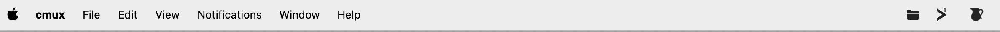

# ShotCubby

Every screenshot you take, automatically collected in one folder and one click away.
A small menu bar (macOS) / system tray (Windows) app.



## Why

Screenshots pile up on the Desktop, get lost in Downloads, or vanish in the
clipboard. ShotCubby quietly catches all of them, files them in a single place,
and lets you find, copy or rename any of them in a couple of keystrokes.

- **Nothing to do** — keep taking screenshots the way you already do.
- **One place** — `Documents/ShotCubby` on both macOS and Windows by default, movable from Settings.
- **Fast to reach** — a Spotlight-style search opens from anywhere.
- **Safe** — deleting always goes to the Trash / Recycle Bin, never permanently.
- **Private** — works entirely on your machine: no account, no tracking, your
  screenshots never leave it. The only network requests are the update check
  (see [Updates](#updates)) and, only if you turn it on, AI naming (below).
- **AI naming (optional, off by default)** — add your own Anthropic or OpenAI
  API key in Settings and each new screenshot is renamed after what it shows. Only
  then is a downscaled copy of the screenshot sent to the provider you chose, with
  your key; the key is stored in the macOS Keychain / Windows Credential Manager.

## What it captures

| macOS | Windows | What happens |
|---|---|---|
| `Cmd + Shift + 3` | `Alt + Shift + 3` | Full screen → filed in your ShotCubby folder |
| `Cmd + Shift + 4` | `Alt + Shift + 4` | Selected area → filed in your ShotCubby folder |
| `Cmd + Shift + Ctrl + 3 / 4` | `Win + Shift + S` | Copied to the clipboard → saved to your ShotCubby folder |

On Windows the capture shortcuts can be changed freely in **Settings**; on macOS
the system's own screenshot shortcuts are used.

## Using it

**On macOS the app also sits in the Dock**: clicking its icon opens the search panel (turn it off in Settings → Show in the Dock).
**On Windows**, launching ShotCubby again (Start menu, desktop shortcut, or its pinned taskbar icon) opens the search panel in the running copy instead of starting a second one — pin it to the taskbar for a one-click icon.

**Click the menu bar / tray icon** for your recent screenshots, grouped by day, with
thumbnails. Click one to open it; hover to copy, reveal in the file manager or delete;
double-click a name to rename it.

**Open the search from anywhere** with the global shortcut (default
`Cmd + /` on macOS, `Ctrl + /` on Windows — both customizable in Settings),
then type to filter and use the keyboard:

| Action | macOS | Windows |
|---|---|---|
| Move in the list | `↑` `↓` | `↑` `↓` |
| Preview | `↩` | `Enter` |
| Copy | `Cmd + C` | `Ctrl + C` |
| Rename | `Cmd + E` | `Ctrl + E` |
| Open folder | `Cmd + R` | `Ctrl + R` |
| Move to Trash | `Cmd + ⌫` | `Ctrl + ⌫` |
| All actions menu | `Cmd + K` | `Ctrl + K` |
| Settings | `Cmd + ,` | `Ctrl + ,` |
| Close | `Esc` | `Esc` |

**Settings** let you switch between the light and dark look (light by default),
open ShotCubby when you log in, change the search shortcut (and, on Windows, the
capture shortcuts) and pick where your screenshots are kept.

## Install

Download the installer for your system from the
[latest release](https://github.com/Nelahia/shotcubby/releases/latest):

- **macOS 14+**: `ShotCubby.dmg`, then drag the app to Applications.
- **Windows 10/11**: `ShotCubby-Setup.exe` (or `ShotCubby.msi`).

To open ShotCubby when you log in, turn on **Settings → General → Open ShotCubby when I log in**.

## Updates

- **Windows**: ShotCubby checks for a new version a few seconds after launch, then every
  few hours, and installs it automatically before restarting. Each update is verified
  against the project's signing key, so only releases published by the maintainer can
  install. The check is a single request to this repository's
  [GitHub releases](https://github.com/Nelahia/shotcubby/releases); it sends no
  personal data and no identifier. Turn it off in **Settings → Install updates
  automatically**.
- **macOS**: ShotCubby checks for a new version about once a day (and on **Settings →
  Check for Updates…**, or from the right-click menu of the menu bar icon). When one is
  available, a window offers to install it; the download is verified against the
  project's signing key before it replaces the app, and ShotCubby restarts. This is done
  with [Sparkle](https://sparkle-project.org). The check is a single request to this
  repository's [GitHub releases](https://github.com/Nelahia/shotcubby/releases) and sends
  no personal data. Turn the automatic checks off in Settings.

## Code signing policy

Windows installers are signed through the free open-source program of the
SignPath Foundation: free code signing provided by [SignPath.io](https://signpath.io),
certificate by [SignPath Foundation](https://signpath.org).

- Only binaries built by the [release workflow](.github/workflows/release.yml)
  from this repository's tagged source are submitted for signing.
- The maintainer ([Nelahia](https://github.com/Nelahia)) is the sole author,
  reviewer and approver of signing requests.
- **Privacy**: ShotCubby works entirely on your machine. It does not collect any
  data, and the project receives none. By default the only network request the app
  makes is the optional update check described in [Updates](#updates), which sends
  nothing about you. The one other request is the optional AI naming feature,
  off by default: once you turn it on with your own API key, a downscaled copy of
  each new screenshot goes to the provider you chose, never to this project.

## Building from source

The two apps are independent native projects that share no code:

```
apps/
├── macos/      Swift / SwiftUI menu-bar app, built with XcodeGen + Xcode
└── windows/    Tauri tray app (Rust backend, plain HTML/CSS/JS frontend)
```

See [apps/macos](apps/macos/README.md) and [apps/windows](apps/windows/README.md) for
requirements and build steps. Releases for both are built by the
[release workflow](.github/workflows/release.yml).

## License

[MIT](LICENSE)

ShotCubby is provided as is, without warranty of any kind — see [LICENSE](LICENSE). To report a security problem, see [SECURITY.md](SECURITY.md).
